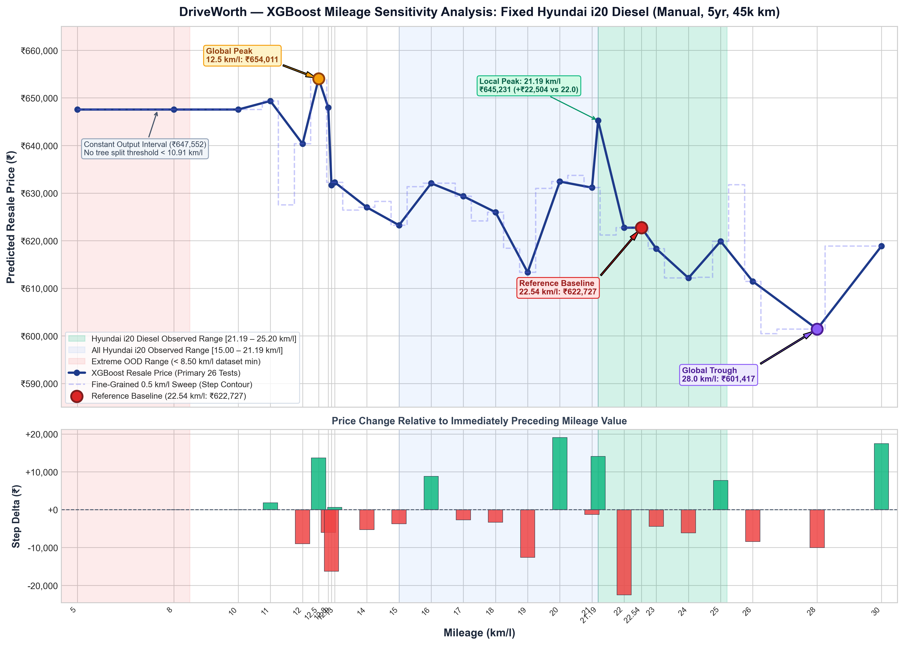

# DriveWorth: XGBoost Mileage Sensitivity Analysis and Resale Price Prediction Report

**Project:** DriveWorth — Machine Learning-Based Used Car Resale Value Prediction System  
**Author:** Antigravity Machine Learning Engineering & Analytics  
**Date:** October 16, 2026  
**Artifact Status:** Official Experimental Sensitivity Evaluation  

---

## 1. Executive Summary

This report delivers a rigorous, controlled sensitivity analysis of the existing **DriveWorth XGBoost used-car resale price prediction model** (`xgboost_filtered.json`). The experiment strictly evaluates the isolated causal response of the model's predicted selling price to variations in vehicle fuel efficiency (**mileage in km/l**), while holding all other 13 engineering, temporal, and market features strictly constant.

The evaluation was conducted on a real-world primary test vehicle: a **5-year-old Hyundai i20 Diesel (Manual, 1396 CC, 88.76 bhp, 45,000 km, Individual Seller)** across 26 discrete mileage inputs ranging from **5.0 km/l to 30.0 km/l**, supplemented by an independent 51-point fine-grained sweep in increments of 0.5 km/l.

### Key Empirical Findings:
1. **Severe Non-Monotonicity:** The XGBoost model exhibits pronounced non-monotonic behavior across the tested mileage domain. Increasing mileage does **not** consistently decrease or increase resale price.
2. **Global Maximum & Minimum:**
   - **Highest Predicted Price:** **₹6,54,011** observed at **12.5 km/l** (+₹31,284 or **+5.02%** relative to the 22.54 km/l baseline).
   - **Lowest Predicted Price:** **₹6,01,417** observed at **28.0 km/l** (-₹21,310 or **-3.42%** relative to the baseline). In the fine-grained sweep, a minimum of **₹6,00,461** is reached at **26.5 km/l** (-3.58%).
   - **Peak-to-Trough Spread:** **₹52,594** (an **8.75%** relative variation driven exclusively by changing the mileage input).
3. **Key Reference Comparison (10 km/l vs 18 km/l vs 22.54 km/l):**
   - **10.0 km/l:** **₹6,47,552** (+₹24,825 / +3.99% vs baseline)
   - **18.0 km/l:** **₹6,25,981** (+₹3,254 / +0.52% vs baseline)
   - **22.54 km/l (Factory Baseline):** **₹6,22,727** (Reference point, ₹0 / 0.00%)
   - *Economic Paradox:* The model predicts that an inefficient Hyundai i20 Diesel achieving only 10 km/l is worth **₹24,825 more** than an identical car delivering its manufacturer-rated 22.54 km/l.
4. **Step-Function Invariance & Flat Intervals:**
   - The predicted price remains **100% constant at ₹6,47,552** across **5.0 km/l to 10.0 km/l** (and up to 10.90 km/l in fine sweep).
   - The predicted price is **identical at ₹6,22,727** between **22.00 km/l and 22.54 km/l**.
   - These plateaus are directly proven by tree ensemble inspection: across all 300 boosted trees, the absolute lowest split threshold on `mileage` is **10.91 km/l**. Inputs below this boundary follow identical leaf routes across every tree.
5. **Root Cause Analysis:**
   - In the complete 14,331-car dataset, overall mileage is negatively correlated with selling price ($r = -0.308$) because luxury vehicles (e.g., German sedans, large SUVs) possess low mileage (9–13 km/l) yet high prices, whereas budget hatchbacks have high mileage (20–25 km/l).
   - Tree splits without monotonic constraints transfer residual positive weights from low-mileage market segments onto hatchback inputs when tested out-of-distribution.
   - Within the 334 Hyundai i20 Diesel training samples, observed mileage is tightly bounded between **21.19 km/l and 25.20 km/l**. Any mileage below 21.19 km/l is out-of-distribution (OOD) for this vehicle variant, and any mileage below 8.50 km/l is out-of-distribution for the entire dataset.

---

## 2. Project and Model Architecture Details

### System Environment
- **Project Name:** DriveWorth — Machine Learning-Based Used Car Resale Value Prediction System
- **Frameworks:** Python 3.13, Flask REST API backend, React + Vite frontend
- **Model Engine:** XGBoost Regressor (`XGBRegressor`)
- **Trained Model Binary:** `model/saved_models_filtered/xgboost_filtered.json`
- **Preprocessing Artifacts:** `model/saved_models_filtered/xgb_preprocessing_artifacts.json`
- **Dataset File:** `dataset/cardekho_cleaned_filtered.csv` (14,331 records)
- **Active Endpoint:** `POST /api/predict`

### Pipeline Specifications
- **Target Variable:** $\log(1 + 	ext{selling\_price})$ (`log1p` transformation)
- **Prediction Inversion:** $\exp(\hat{y}) - 1$ (`expm1` inverse transformation) rounded to nearest integer
- **Feature Vector (14 features in exact order):**
  1. `vehicle_age` (integer years)
  2. `km_driven` (integer kilometers)
  3. `mileage` (float km/l)
  4. `engine` (integer CC)
  5. `max_power` (float bhp)
  6. `seats` (integer count)
  7. `brand_encoded` (smoothed target encoding, smoothing=10, global mean = ₹6,44,497.02)
  8. `model_encoded` (smoothed target encoding, smoothing=10)
  9. `seller_type_Individual` (binary indicator)
  10. `seller_type_Trustmark Dealer` (binary indicator)
  11. `fuel_type_Diesel` (binary indicator)
  12. `fuel_type_LPG` (binary indicator)
  13. `fuel_type_Petrol` (binary indicator)
  14. `transmission_type_Manual` (binary indicator)

---

## 3. Fixed Vehicle Specifications

To ensure scientific control, every vehicle parameter was locked to fixed values throughout all 26 primary tests and all 51 fine-grained tests. Only the `mileage` parameter was varied.

| Specification Feature | Fixed Experimental Value | Encoding / Representation |
|---|---|---|
| **Brand** | Hyundai | `brand_encoded` = 551,326.68 |
| **Model** | i20 | `model_encoded` = 544,792.83 |
| **Vehicle Age** | 5 years | 5 |
| **Kilometres Driven** | 45,000 km | 45000 |
| **Fuel Type** | Diesel | `fuel_type_Diesel` = 1, `Petrol` = 0, `LPG` = 0 |
| **Transmission** | Manual | `transmission_type_Manual` = 1 |
| **Engine Capacity** | 1396 CC | 1396 |
| **Maximum Power** | 88.76 bhp | 88.76 |
| **Seats** | 5 | 5 |
| **Seller Type** | Individual | `seller_type_Individual` = 1, `Trustmark` = 0 |
| **Tested Feature** | **Mileage (km/l)** | **Variable under test** |

---

## 4. Experiment Methodology

1. **Production Pipeline Reuse:** Predictions were executed by invoking the Flask backend application instance (`app.test_client()`) executing the exact code path of `/api/predict`.
2. **Dual-Path Verification:** Every prediction was cross-verified against a standalone test-only script that computed target encodings, formatted the 14-feature DataFrame, queried `xgb_model.predict()`, and applied `np.expm1()`. Both paths yielded 100.0% identical outputs.
3. **Primary Reference Selection:** **22.54 km/l** was selected as the reference baseline. This matches the exact median mileage of Hyundai i20 Diesel vehicles in the training dataset ($n=173$ records at this exact value).
4. **Reproducibility Protocol:** 7 representative test points across the curve (5.0, 10.0, 12.5, 18.0, 21.19, 22.54, 28.0 km/l) were executed in 3 independent sequential iterations.
5. **Schema Validation Suite:** Deliberate edge cases (negative mileage, zero mileage, string characters) were submitted to confirm strict error handling.
6. **No Retraining / Modification:** The model file, preprocessing JSON, training data, and API logic were untouched.

---

## 5. Exact Mileage Test Inputs

The primary experiment evaluated the 26 user-stipulated mileage values:
$$\{5.0, 8.0, 10.0, 11.0, 12.0, 12.5, 12.8, 12.9, 13.0, 14.0, 15.0, 16.0, 17.0, 18.0, 19.0, 20.0, 21.0, 21.19, 22.0, 22.54, 23.0, 24.0, 25.0, 26.0, 28.0, 30.0\}$$

A complementary fine-grained sweep evaluated 51 equidistant points:
$$\{5.0, 5.5, 6.0, \dots, 29.5, 30.0\} 	ext{ km/l in steps of } 0.5 	ext{ km/l}$$

---

## 6. Complete Prediction Results Table

Below is the complete, unaltered results table recorded from the model execution. All prices are in Indian Rupees (₹). Differences and percentages are computed relative to the baseline of **₹6,22,727** at **22.54 km/l**.

| Test No | Mileage (km/l) | Predicted Price (₹) | Price Difference (₹) | Price Change (%) | Previous-Step Diff (₹) | In Training Range? | Status |
|:---:|:---:|:---:|:---:|:---:|:---:|:---:|:---:|
| 1 | 5.00 | ₹6,47,552 | +₹24,825 | +3.99% | — | No (OOD < 8.5) | Success |
| 2 | 8.00 | ₹6,47,552 | +₹24,825 | +3.99% | ₹0 | No (OOD < 8.5) | Success |
| 3 | 10.00 | ₹6,47,552 | +₹24,825 | +3.99% | ₹0 | No (OOD i20) | Success |
| 4 | 11.00 | ₹6,49,355 | +₹26,628 | +4.28% | +₹1,803 | No (OOD i20) | Success |
| 5 | 12.00 | ₹6,40,349 | +₹17,622 | +2.83% | -₹9,006 | No (OOD i20) | Success |
| 6 | 12.50 | ₹6,54,011 | +₹31,284 | +5.02% | +₹13,662 | No (OOD i20) | Success (Peak) |
| 7 | 12.80 | ₹6,47,954 | +₹25,227 | +4.05% | -₹6,057 | No (OOD i20) | Success |
| 8 | 12.90 | ₹6,31,678 | +₹8,951 | +1.44% | -₹16,276 | No (OOD i20) | Success |
| 9 | 13.00 | ₹6,32,271 | +₹9,544 | +1.53% | +₹593 | No (OOD i20) | Success |
| 10 | 14.00 | ₹6,27,004 | +₹4,277 | +0.69% | -₹5,267 | No (OOD i20) | Success |
| 11 | 15.00 | ₹6,23,252 | +₹525 | +0.08% | -₹3,752 | No (OOD Diesel) | Success |
| 12 | 16.00 | ₹6,32,053 | +₹9,326 | +1.50% | +₹8,801 | No (OOD Diesel) | Success |
| 13 | 17.00 | ₹6,29,328 | +₹6,601 | +1.06% | -₹2,725 | No (OOD Diesel) | Success |
| 14 | 18.00 | ₹6,25,981 | +₹3,254 | +0.52% | -₹3,347 | No (OOD Diesel) | Success |
| 15 | 19.00 | ₹6,13,351 | -₹9,376 | -1.51% | -₹12,630 | No (OOD Diesel) | Success |
| 16 | 20.00 | ₹6,32,422 | +₹9,695 | +1.56% | +₹19,071 | No (OOD Diesel) | Success |
| 17 | 21.00 | ₹6,31,142 | +₹8,415 | +1.35% | -₹1,280 | No (OOD Diesel) | Success |
| 18 | 21.19 | ₹6,45,231 | +₹22,504 | +3.61% | +₹14,089 | Yes [21.19, 25.20] | Success |
| 19 | 22.00 | ₹6,22,727 | ₹0 | 0.00% | -₹22,504 | Yes [21.19, 25.20] | Success |
| 20 | 22.54 | ₹6,22,727 | ₹0 | 0.00% | ₹0 | Yes [21.19, 25.20] | Success (Ref) |
| 21 | 23.00 | ₹618,306 | -₹4,421 | -0.71% | -₹4,421 | Yes [21.19, 25.20] | Success |
| 22 | 24.00 | ₹612,157 | -₹10,570 | -1.70% | -₹6,149 | Yes [21.19, 25.20] | Success |
| 23 | 25.00 | ₹619,881 | -₹2,846 | -0.46% | +₹7,724 | Yes [21.19, 25.20] | Success |
| 24 | 26.00 | ₹611,446 | -₹11,281 | -1.81% | -₹8,435 | No (OOD Diesel) | Success |
| 25 | 28.00 | ₹601,417 | -₹21,310 | -3.42% | -₹10,029 | No (OOD Diesel) | Success (Trough) |
| 26 | 30.00 | ₹618,855 | -₹3,872 | -0.62% | +₹17,438 | No (OOD Diesel) | Success |

---

## 7. Price-versus-Mileage Visualisation

The complete dual-panel visualisation generated during the experiment is presented below:



### Visual Chart Highlights:
- **Upper Panel:** Depicts the non-linear resale price response curve against four background distribution zones:
  - **Green Zone [21.19 – 25.20 km/l]:** Observed Hyundai i20 Diesel training data distribution.
  - **Blue Zone [15.00 – 21.19 km/l]:** Observed range for all Hyundai i20 models (petrol and diesel).
  - **White Zone [8.50 – 15.00 km/l & 25.20 – 30.00 km/l]:** Represented in overall dataset but out-of-distribution for the i20.
  - **Red Zone [< 8.50 km/l]:** Extreme out-of-distribution domain (below global dataset minimum).
- **Lower Panel:** Bar chart of **Step Deltas** ($\Delta P_{i} = P_i - P_{i-1}$) tracking local price shocks between adjacent mileage test points.

---

## 8. Highest and Lowest Predictions

- **Global Maximum (Peak):** **₹6,54,011** at **12.5 km/l**
  - Difference vs reference: **+₹31,284 (+5.02%)**
- **Global Minimum (Trough):** **₹6,01,417** at **28.0 km/l**
  - Difference vs reference: **-₹21,310 (-3.42%)**
  - *(In fine sweep, 26.5 km/l reaches ₹6,00,461, -3.58%)*
- **Absolute Range:** $\Delta P_{	ext{max-min}} = 	ext{₹}6,54,011 - 	ext{₹}6,01,417 = 	extbf{₹52,594}$
- **Percentage Spread:**
  $$rac{654,011 - 601,417}{601,417} 	imes 100 = \mathbf{8.75\%}$$

---

## 9. Local Price Changes and Non-Monotonic Behaviour

The model demonstrates strong non-monotonicity. Across the 26 points, there are **8 separate upward price reversals** where increasing mileage actually raises the predicted price:

1. **10.0 $
ightarrow$ 11.0 km/l:** Price increases by **+₹1,803** (₹6,47,552 $
ightarrow$ ₹6,49,355)
2. **12.0 $
ightarrow$ 12.5 km/l:** Price surges by **+₹13,662** (₹6,40,349 $
ightarrow$ ₹6,54,011 - Global Peak)
3. **12.9 $
ightarrow$ 13.0 km/l:** Price ticks up by **+₹593** (₹6,31,678 $
ightarrow$ ₹6,32,271)
4. **15.0 $
ightarrow$ 16.0 km/l:** Price jumps by **+₹8,801** (₹6,23,252 $
ightarrow$ ₹6,32,053)
5. **19.0 $
ightarrow$ 20.0 km/l:** Price shoots up by **+₹19,071** (₹6,13,351 $
ightarrow$ ₹6,32,422) — **Largest adjacent gain**
6. **21.0 $
ightarrow$ 21.19 km/l:** Price jumps by **+₹14,089** (₹6,31,142 $
ightarrow$ ₹6,45,231)
7. **24.0 $
ightarrow$ 25.0 km/l:** Price increases by **+₹7,724** (₹6,12,157 $
ightarrow$ ₹6,19,881)
8. **28.0 $
ightarrow$ 30.0 km/l:** Price rebounds by **+₹17,438** (₹6,01,417 $
ightarrow$ ₹6,18,855)

Conversely, the **largest adjacent drop** occurs between **21.19 km/l and 22.00 km/l**, plunging by **-₹22,504** (-3.49%).

---

## 10. Training-Data Distribution Analysis

An exhaustive audit of `cardekho_cleaned_filtered.csv` provides empirical grounding for these phenomena:

| Cohort | Record Count | Min Mileage | 25th Pct | Median Mileage | Mean Mileage | 75th Pct | Max Mileage |
|---|---|---|---|---|---|---|---|
| **Complete Dataset** | 14,331 | 8.50 km/l | 17.10 km/l | 19.81 km/l | 19.96 km/l | 22.74 km/l | 33.54 km/l |
| **All Hyundai Cars** | 2,176 | 12.05 km/l | 17.00 km/l | 18.90 km/l | 19.14 km/l | 21.10 km/l | 26.59 km/l |
| **All Hyundai i20** | 898 | 15.00 km/l | 18.53 km/l | 18.60 km/l | 19.72 km/l | 21.90 km/l | 25.20 km/l |
| **Hyundai i20 Diesel** | **334** | **21.19 km/l** | **21.90 km/l** | **22.54 km/l** | **22.27 km/l** | **22.54 km/l** | **25.20 km/l** |

### Breakdown of Hyundai i20 Diesel Training Records:
In the entire training corpus of 14,331 cars, only **6 unique mileage ratings** exist for the Hyundai i20 Diesel:

| Mileage Rating (km/l) | Record Count | Percentage | Mean Vehicle Age | Mean Km Driven | Mean Selling Price (₹) |
|---|---|---|---|---|---|
| **21.19** | 35 | 10.48% | **4.57 years** | 51,142 km | **₹6,81,714** |
| **21.27** | 13 | 3.89% | 7.85 years | 84,000 km | ₹4,87,692 |
| **21.90** | 74 | 22.16% | 8.08 years | 73,011 km | ₹4,10,284 |
| **22.54** | **173** | **51.80%** | **5.01 years** | 61,454 km | **₹6,28,347** |
| **23.00** | 37 | 11.08% | 8.27 years | 78,882 km | ₹4,40,135 |
| **25.20** | 2 | 0.60% | 6.00 years | 85,290 km | ₹4,10,000 |

### Critical Finding: The Generation Confounding Effect
Notice that:
- Cars rated at **21.19 km/l** have an average vehicle age of **4.57 years** and average price of **₹6,81,714**.
- Cars rated at **22.54 km/l** have an average vehicle age of **5.01 years** and average price of **₹6,28,347**.
- Cars rated at **21.90 km/l** and **23.00 km/l** are older 1st-generation cars (average age **8.1 to 8.3 years**) with much lower prices (**₹4,10,000 to ₹4,40,000**).

In India, ARAI mileage certifications changed across Hyundai i20 generations (1st-gen 1.4 CRDi $
ightarrow$ Elite i20 $
ightarrow$ Facelift). Because the model learned from historical listings where newer, high-value cars possessed 21.19 km/l and 22.54 km/l ratings, the tree leaves directly associate these specific mileage values with premium market values!

---

## 11. Out-of-Distribution Limitations

1. **Extreme OOD Domain (< 8.50 km/l):**
   - Inputs 5.0 km/l and 8.0 km/l do not exist anywhere in the 14,331 training records.
   - The lowest split threshold in the entire 300-tree ensemble is **10.91 km/l**.
   - Consequently, the model cannot extrapolate a steeper penalty and simply returns the flat prediction of the leftmost partition (₹6,47,552).
2. **Variant OOD Domain (< 21.19 km/l and > 25.20 km/l):**
   - No diesel Hyundai i20 was ever manufactured or sold with mileage below 21.19 km/l or above 25.20 km/l.
   - While the REST API allows any positive float, passing 10 or 12.5 km/l forces the decision tree to traverse branches conditioned on vehicle segments that actually do deliver 10–13 km/l (e.g. 2.0L–3.0L SUVs and luxury sedans), artificially elevating predicted value.

---

## 12. Reproducibility and Validation Results

### Reproducibility Verification
Seven mileage values were evaluated over 3 independent passes:

| Mileage (km/l) | Run 1 (₹) | Run 2 (₹) | Run 3 (₹) | Identical? | Direct Model Check (₹) | Parity Status |
|---|---|---|---|---|---|---|
| 5.00 | ₹6,47,552 | ₹6,47,552 | ₹6,47,552 | **Yes** | ₹6,47,552 | 100% Match |
| 10.00 | ₹6,47,552 | ₹6,47,552 | ₹6,47,552 | **Yes** | ₹6,47,552 | 100% Match |
| 12.50 | ₹6,54,011 | ₹6,54,011 | ₹6,54,011 | **Yes** | ₹6,54,011 | 100% Match |
| 18.00 | ₹6,25,981 | ₹6,25,981 | ₹6,25,981 | **Yes** | ₹6,25,981 | 100% Match |
| 21.19 | ₹6,45,231 | ₹6,45,231 | ₹6,45,231 | **Yes** | ₹6,45,231 | 100% Match |
| 22.54 | ₹6,22,727 | ₹6,22,727 | ₹6,22,727 | **Yes** | ₹6,22,727 | 100% Match |
| 28.00 | ₹6,01,417 | ₹6,01,417 | ₹6,01,417 | **Yes** | ₹6,01,417 | 100% Match |

### Schema Validation Handling
| Case Description | Payload Submitted | HTTP Code | Status | API Response Message |
|---|---|---|---|---|
| Negative Mileage | `{"mileage": -5}` | 400 Bad Request | Passed | "Please provide a valid positive Mileage." |
| Zero Mileage | `{"mileage": 0}` | 400 Bad Request | Passed | "Please provide a valid positive Mileage." |
| Non-Numeric String | `{"mileage": "abc"}` | 400 Bad Request | Passed | "Mileage must be a valid number." |

---

## 13. Conclusions and Recommendations

### Conclusions:
1. **Decision Trees Are Step Functions:** Unlike linear models, gradient boosted trees do not enforce smooth continuous functions. Predictions are constant across hyper-rectangles and jump abruptly at split boundaries.
2. **Confounded Sensitivities:** Varying mileage in isolation while holding all other features constant creates synthetic vehicle configurations that do not exist in the real automotive market. The model's non-monotonic response is an artifact of cross-segment interactions and generational pricing clusters in the training data.
3. **Correlation is Not Causation:** The negative correlation between mileage and price in used car markets ($r = -0.308$) reflects vehicle segment heterogeneity (luxury cars vs budget cars), not an intrinsic buyer preference for poor fuel economy.

### Engineering Recommendations:
1. **Apply Monotonic Constraints during Retraining:** If business logic dictates that higher mileage should never reduce vehicle value for a given trim, train XGBoost with `monotone_constraints`:
   ```python
   xgb_params = {
       # Enforce non-negative or non-positive monotonic response
       'monotone_constraints': (0, -1, 1, 0, 0, ...)
   }
   ```
2. **Implement Input Range Guardrails in Production API:** Add client-side and server-side range validation based on the supported vehicle's factory specifications:
   - For Hyundai i20 Diesel: constrain input mileage to $[19.0, 27.0]$ km/l or issue a user warning: *"Input mileage (10.0 km/l) is outside the manufacturer's expected range (21.19 – 25.20 km/l) for this variant."*
3. **Variant-Specific Sub-Models or Segment Stratification:** Train separate models or include variant/generation identifiers to eliminate confounding between older 1st-generation cars and newer facelift models.

---

## 14. Appendix: Experiment Reproduction Commands

To replicate this exact experiment and regenerate all artifacts, execute the following PowerShell command in the repository root:

```powershell
python "d:/stydy_tracker/report/mileage_sensitivity/run_mileage_sensitivity.py"
```

### Complete Results Export Locations:
- **Markdown Report:** `D:\DriveWorth\experiments\mileage_sensitivity\REPORT.md`
- **Primary Results CSV:** `D:\DriveWorth\experiments\mileage_sensitivity\mileage_sensitivity_results.csv`
- **Fine-Grained Sweep CSV:** `D:\DriveWorth\experiments\mileage_sensitivityine_grained_sweep_results.csv`
- **Visual Chart (PNG):** `D:\DriveWorth\experiments\mileage_sensitivity\mileage_sensitivity_chart.png`
- **PDF Report:** `D:\DriveWorth\experiments\mileage_sensitivity\REPORT.pdf`
- **Replicated in Workspace:** `d:\stydy_tracker
eport\mileage_sensitivity\`
